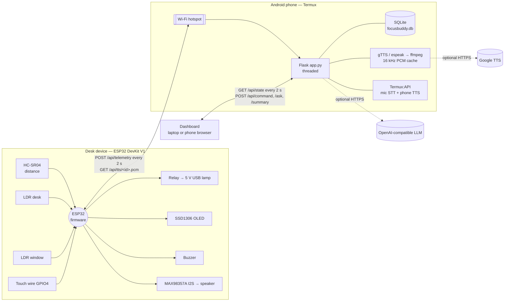
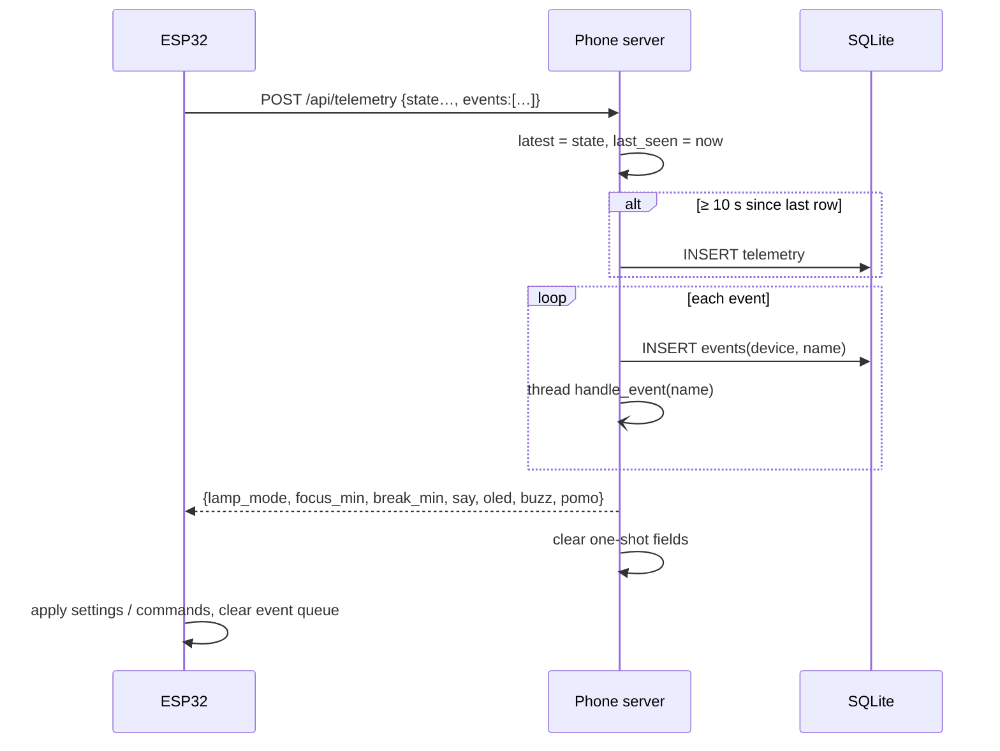
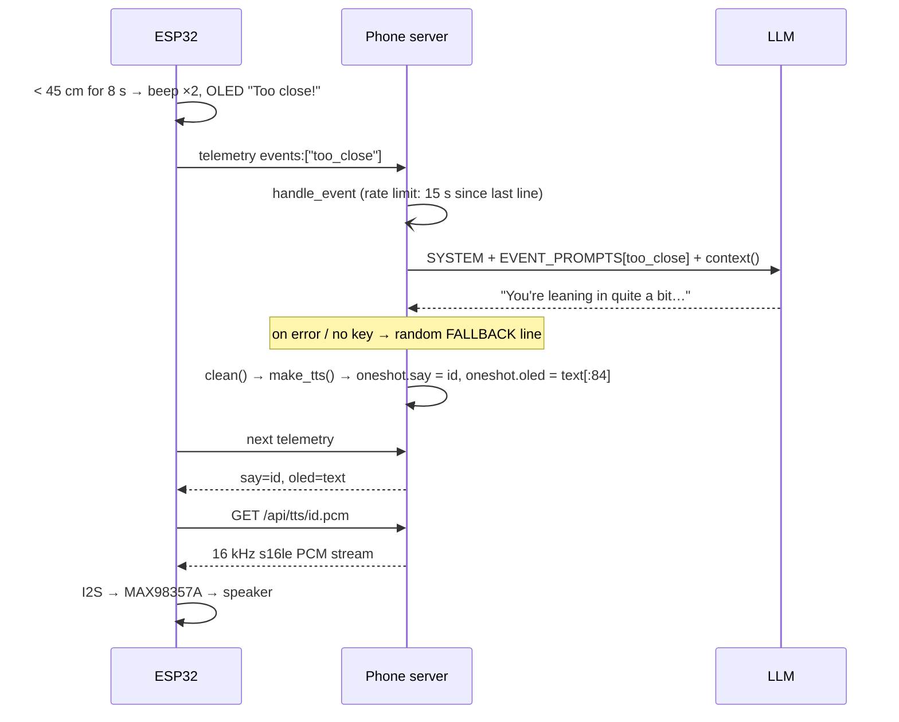
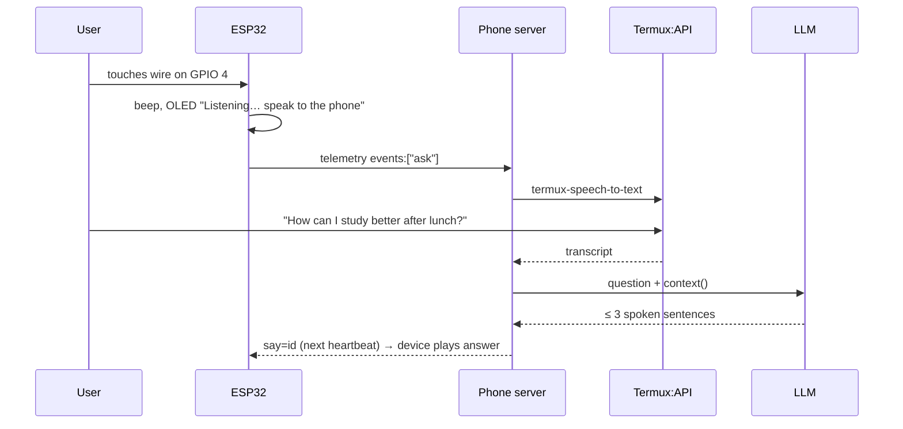
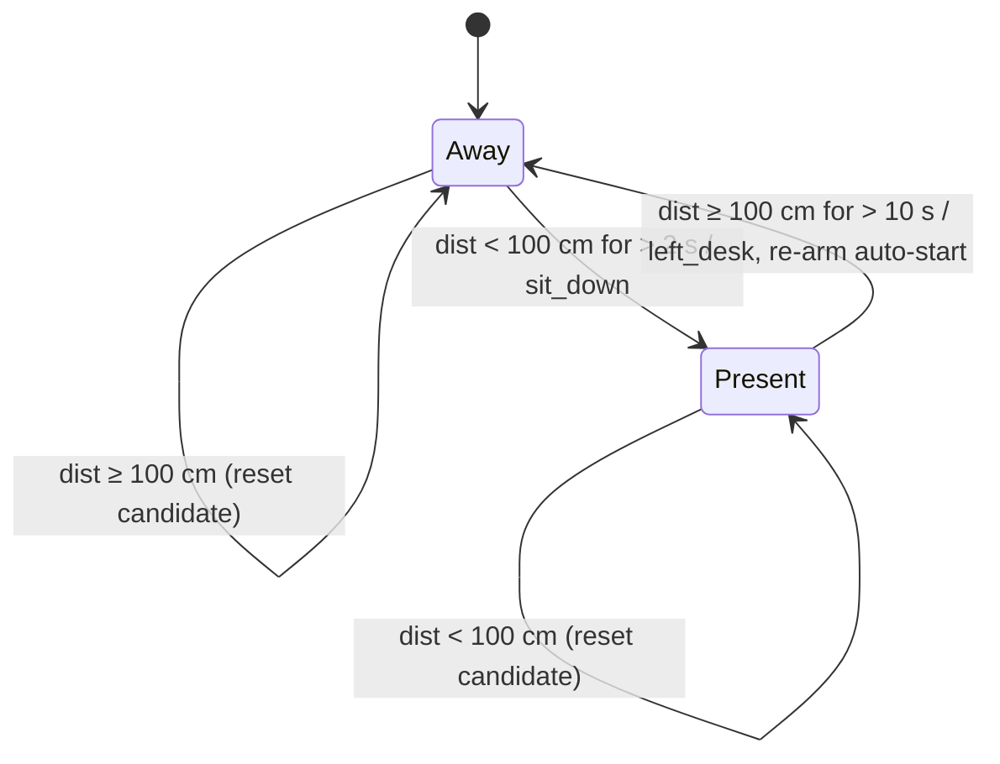
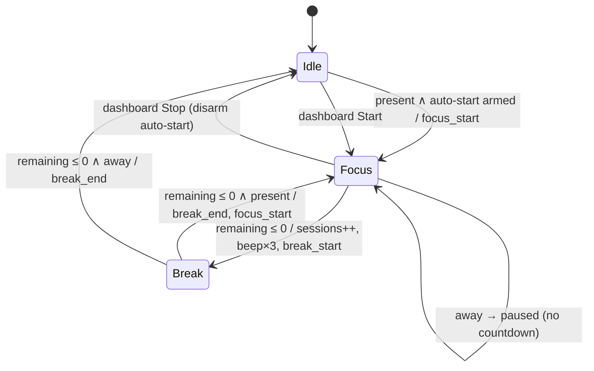
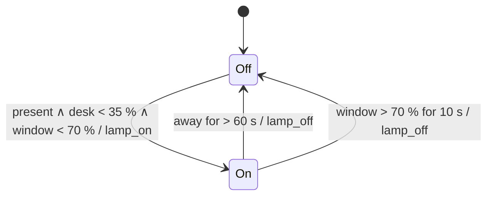
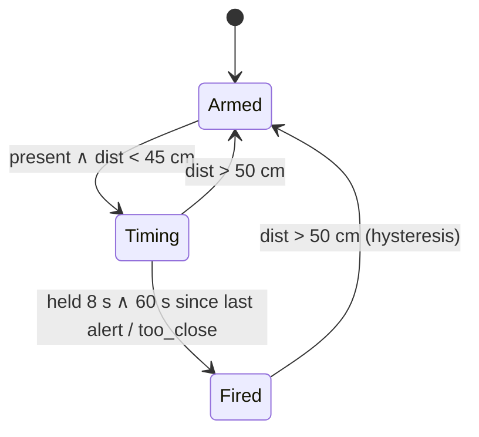

# FocusBuddy — Architecture

FocusBuddy is a two-tier edge system. A **desk device** (ESP32) handles sensing and real-time control. A **phone server** (Android + Termux + Flask) handles AI, voice, storage and the UI. There is no cloud backend. The only calls leaving the phone are optional ones to an LLM API and Google TTS.

## 1. System context



## 2. Components

### 2.1 ESP32 firmware (`focusbuddy_esp32.ino`)

A single cooperative loop built on `millis()`. No RTOS tasks are created by the sketch.

| Cadence | Work |
|---|---|
| 150 ms | Ultrasonic ping → ring buffer of 5 → median distance |
| 500 ms | Desk + window LDR, 8-sample average each, → 0–100 % |
| every loop | `updatePresence` → `updateTooClose` → `updateLamp` → `updatePomo(dt)` → `checkTouch` |
| 250 ms | Redraw OLED |
| 2 s | `syncServer()`: POST telemetry + events, apply response, play pending TTS |
| 15 s | Wi-Fi reconnect attempt if disconnected (latest firmware) |
| 1 s | Serial calibration line |

All thresholds and hardware polarity flags are in the `USER CONFIG` block (see [SETUP §3](../focusbuddy/SETUP.md)).

### 2.2 Phone server (`app.py`)

| Module area | Responsibility |
|---|---|
| Routes | `/`, `/api/telemetry`, `/api/tts/<id>.pcm`, `/api/state`, `/api/command`, `/api/ask`, `/api/listen`, `/api/summary` ([API.md](API.md)) |
| State | `latest` (last telemetry), `settings` (lamp mode, focus/break min), `oneshot` (say/oled/buzz/pomo delivered once), `recent` (deque of 80 events) |
| Concurrency | Flask `threaded=True`; `state_lock` guards in-memory state, `db_lock` serialises SQLite; each device event and each speak runs on a daemon thread |
| AI | `llm()` → OpenAI-compatible chat completions; `context()` builds grounding; `clean()` sanitises output |
| Speech out | `make_tts()` gTTS→MP3 or espeak→WAV, then ffmpeg → s16le 16 kHz mono PCM; `phone_say()` fallback |
| Speech in | `listen_phone()` → `termux-speech-to-text` (40 s timeout) |
| Storage | SQLite file next to `app.py`; connection per query |

### 2.3 Dashboard (`static/index.html`)

Single HTML file with no build step: vanilla JS, CSS grid, Chart.js 4 from CDN. It polls `/api/state` every 2 s and re-renders tiles, charts and the activity log. Controls `POST` to `/api/command`, `/api/ask`, `/api/listen` and `/api/summary`. All event text is passed through `escapeHtml()`.

## 3. Key flows

### 3.1 Telemetry heartbeat (every 2 s)



The device's event queue is cleared **only on HTTP 200**, so events survive a dropped request.

### 3.2 Coaching event (e.g. `too_close`)



### 3.3 Voice question via touch



### 3.4 Daily report

`POST /api/summary` aggregates today's rows (`AVG(desk)`, `AVG(win)`, `SUM(present)`, `MAX(focus_s)`, `MAX(sessions)`, event counts, best focus hour) into a facts string. The LLM turns that into a 3–4 sentence report plus exactly two `Tip:` lines. Without a key, the facts plus two default tips are returned. If `speak: true`, the first two sentences are spoken.

## 4. Device state machines

### 4.1 Presence



### 4.2 Pomodoro



The break timer runs whether or not you are present: a break is a break.

### 4.3 Smart lamp (auto mode)



**Why two sensors:** once the lamp is on, the desk sensor measures the lamp itself and would immediately say "bright enough". So the desk sensor only decides **ON**, and the window sensor, aimed away from the lamp, decides **OFF**. Modes `on` / `off` from the dashboard override auto.

### 4.4 Too-close alert



## 5. Data model (SQLite)

```sql
CREATE TABLE telemetry(           -- one row per ≥ 10 s
  ts REAL,          -- unix time
  present INT,      -- 0/1
  distance INT,     -- cm, 999 = no echo
  desk INT,         -- desk light %
  win INT,          -- window light %
  lamp INT,         -- 0/1
  pomo TEXT,        -- idle | focus | break
  focus_s INT,      -- device focus seconds (since device boot)
  sessions INT,     -- completed sessions (since device boot)
  too_close INT     -- too-close alerts (since device boot)
);
CREATE TABLE events(ts REAL, type TEXT, text TEXT);
-- type: device (text = event name) | ai (spoken line) | you (user question) | error | summary
```

Derived metrics: minutes at desk = `SUM(present) × 10 / 60` (each row ≈ 10 s). Focused minutes by hour = the same, restricted to `pomo = 'focus'` and grouped by local hour.

## 6. Audio pipeline

```
LLM text ─► clean() ─► gTTS (MP3, accent TTS_TLD)  ─┐
                    └► espeak (WAV, offline)  ─────┴► ffmpeg -ac 1 -ar 16000 -f s16le ─► tts_cache/<10-hex>.pcm
ESP32: HTTP GET stream ─► 512-sample chunks ─► × VOLUME_PCT ─► duplicate to L+R ─► I2S 16 kHz 16-bit stereo ─► MAX98357A
```

32,000 bytes ≈ 1 s of audio. IDs are 10 random hex characters, validated by regex before any file access.

## 7. Failure modes and graceful degradation

| Failure | Device behaviour | Server behaviour | User sees |
|---|---|---|---|
| No Wi-Fi / phone off | Full local features; OLED "no WiFi"; reconnect every 15 s | — | Timer, lamp, alerts still work |
| Server down | OLED "no AI"; events stay queued (max 8) | — | Same as above |
| No LLM key / LLM error | — | `FALLBACK` lines; error logged | Spoken built-in lines; pill "AI off" |
| No internet for gTTS | — | espeak voice | Robotic but working voice |
| ffmpeg/TTS failure or device offline | — | `termux-tts-speak` on phone | Phone speaks instead |
| STT fails / silence | — | OLED "Sorry, I didn't catch that" | Retry or type on dashboard |
| Dashboard can't reach server | — | — | Pill "Server offline" |

## 8. Timing and threshold reference

| Constant | Default | Where |
|---|---|---|
| `PRESENT_CM` / sit-down hold / away hold | 100 cm / 2 s / 10 s | firmware |
| `CLOSE_CM` / hold / cooldown / re-arm | 45 cm / 8 s / 60 s / > 50 cm | firmware |
| `DESK_DARK_PCT` / `WINDOW_BRIGHT_PCT` | 35 % / 70 % | firmware |
| `WINDOW_OFF_HOLD_MS` / `LAMP_OFF_DELAY_MS` | 10 s / 60 s | firmware |
| Focus / break | 25 / 5 min (dashboard: 50/10, 2/1) | server `settings` → device |
| Telemetry sync / HTTP timeout | 2 s / 1.5 s | firmware |
| Touch threshold / debounce | < 60 % baseline / 4 s | firmware |
| Device online window | 8 s | server |
| DB persist interval | 10 s | server |
| Speech gap / greeting gap | 15 s / 600 s | server |
| LLM timeout / max tokens | 25 s / 120–300 | server |
| TTS cache TTL | 1 h | server |
