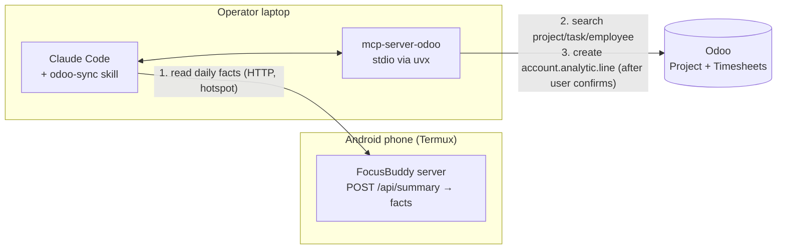

# Odoo Integration (via MCP + Claude Code)

> **Status: planned (roadmap M3).** This repo ships a reference MCP configuration ([`.mcp.json`](../.mcp.json)) and an agent skill ([`odoo-sync`](../.claude/skills/odoo-sync/SKILL.md)). The integration is **not connected in the hackathon build**, and no FocusBuddy code calls Odoo today. This document is the design.

## 1. Why Odoo

Many schools, coaching centres, internships and small companies run on **Odoo** (Project, Timesheets, Employees; Odoo-based education ERPs also exist). Students and interns are often asked to log study or work hours by hand. FocusBuddy already measures **real** focus time: the timer pauses when you leave the desk. So it can fill timesheets with numbers that are measured instead of estimated.

| User | Value |
|---|---|
| Intern / remote worker | Daily focus hours logged to the right Odoo task automatically |
| Mentor / teacher | Sees honest effort per project without surveillance (totals only, no sensor feeds) |
| Organisation | Wellbeing signal (break adherence) alongside project time |

## 2. Approach: MCP first, native later

**Phase A — MCP-assisted (this design).** The student or operator uses **Claude Code** with the community **Odoo MCP server** ([`mcp-server-odoo`](https://github.com/ivnvxd/mcp-server-odoo)). Claude reads the day's facts from FocusBuddy, finds the right Odoo project/task, drafts a timesheet line, asks for confirmation, then creates it. There is no new server code on the phone and a human approves every write.

**Phase B — native (later).** If pilots like it, the phone server posts a daily timesheet line itself through Odoo's external API, using the same mapping and guardrails.



## 3. Reference configuration

[`.mcp.json`](../.mcp.json) (project scope, picked up by Claude Code in this folder):

```json
{
  "mcpServers": {
    "odoo": {
      "type": "stdio",
      "command": "uvx",
      "args": ["mcp-server-odoo"],
      "env": {
        "ODOO_URL": "${ODOO_URL:-https://your-company.odoo.com}",
        "ODOO_DB": "${ODOO_DB:-your-database}",
        "ODOO_API_KEY": "${ODOO_API_KEY:-set-ODOO_API_KEY-in-your-shell}"
      }
    }
  }
}
```

- Values are **environment-variable references** with placeholder defaults. No credentials are stored in the repo.
- Claude Code asks for approval before starting a project MCP server. Decline it until you've set up an Odoo instance.
- `uvx` (from `uv`) downloads and runs the server on demand. Nothing is installed into the project.

### To enable it later

```bash
# 1. In Odoo: create a dedicated API user with access to Project + Timesheets only,
#    generate an API key (Preferences → Account Security → New API Key),
#    and install the companion Odoo module if the MCP server's README requires one for your mode.
# 2. In your shell (not in any file in this repo):
export ODOO_URL="https://<your-instance>.odoo.com"
export ODOO_DB="<database>"
export ODOO_API_KEY="<api key>"
# 3. Start Claude Code in this folder, approve the "odoo" server, check with /mcp.
```

Check the variable names and Odoo-side requirements against the upstream README before enabling; community servers change between versions.

## 4. Data mapping

| FocusBuddy (source) | Odoo model | Field |
|---|---|---|
| `facts` → focused minutes | `account.analytic.line` | `unit_amount` (hours, rounded to 0.25) |
| Report date | `account.analytic.line` | `date` |
| "FocusBuddy: N sessions, M min focus, K too-close alerts" | `account.analytic.line` | `name` |
| Chosen by user | `project.project` / `project.task` | `project_id` / `task_id` |
| The user | `hr.employee` | `employee_id` |

**Never sent:** distance or light time series, the activity log, spoken AI lines, questions asked to FocusBuddy.

## 5. Example session (target behaviour)

```
You:    Log today's FocusBuddy time to my "DSA Practice" task in Odoo.
Claude: (calls POST /api/summary on the phone)  Focused 96 min across 3 sessions.
        (searches Odoo) Found project "Internship – Training", task "DSA Practice", employee "Ravi K".
        Draft timesheet:
        | Date       | Project               | Task         | Hours | Description                                   |
        | 2026-10-30 | Internship – Training | DSA Practice | 1.50  | FocusBuddy: 3 sessions, 96 min focus, 4 alerts |
        Create this timesheet line? (yes/no)
You:    yes
Claude: Created account.analytic.line #4182.
```

## 6. Guardrails

| Guardrail | Mechanism |
|---|---|
| Credentials only in the environment | `${VAR}` expansion; hook blocks key-shaped strings; `.gitignore` |
| Human approval to start the server | Claude Code project-MCP approval prompt |
| Human approval to change the config | `ask` permission on `.mcp.json` |
| Read before write; one confirmed create per "yes" | `odoo-sync` skill procedure |
| No update / delete; no accounting, payroll or access-rights models | `odoo-sync` skill + least-privilege Odoo user |
| Measured, not inflated | Hours never exceed FocusBuddy's measured focus minutes |
| Honest status | If the `odoo` tools aren't connected, Claude says so and stops |

## 7. Open questions

- Per-task attribution: one task per day, or let the user split sessions across tasks from the dashboard?
- Should mentors see break adherence, or only hours? Consent model needed before any wellbeing data leaves the phone.
- Phase B auth: per-device Odoo API key stored on the phone vs. relaying through a trusted laptop.
